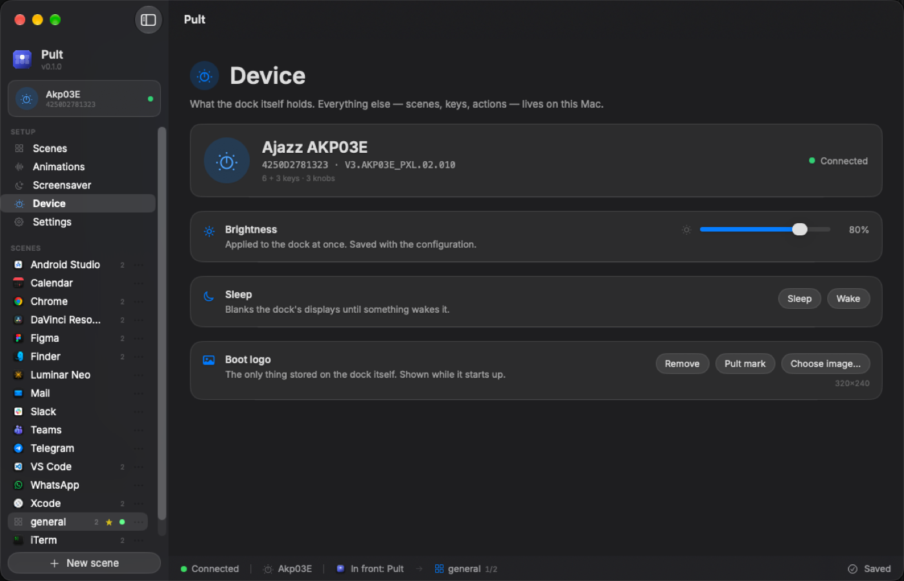
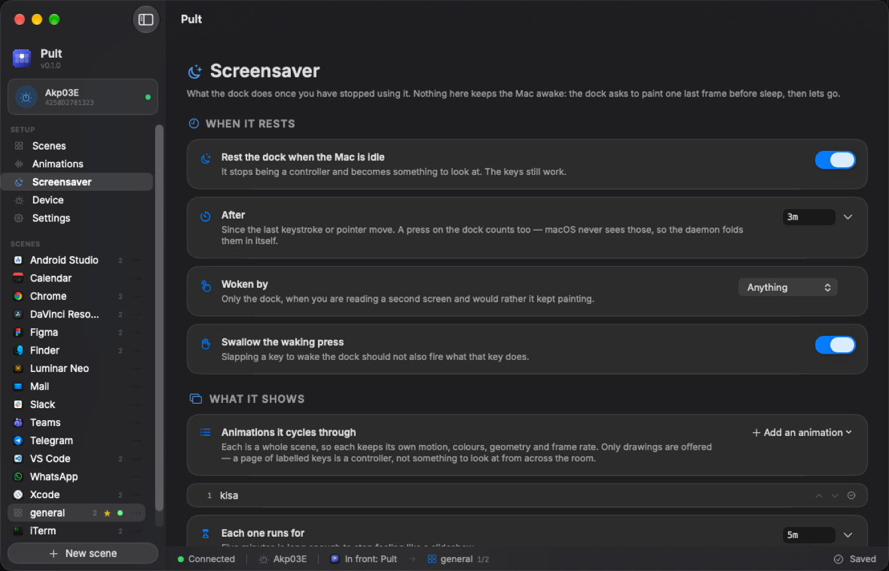
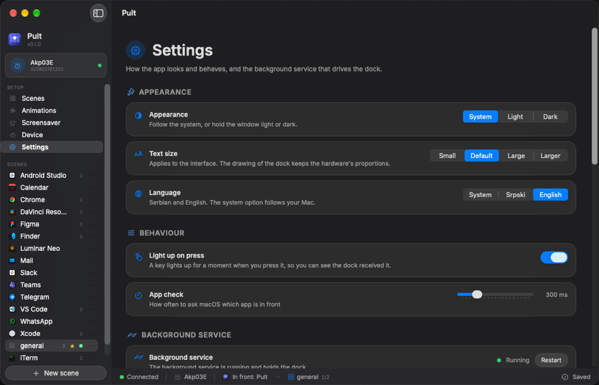

# Pult

A macOS app for the **Ajazz AKP03E** stream dock. The six keys follow whatever
application is in front, and everything about them is editable without touching
a configuration file.


```
macOS frontmost app  →  bundle ID  →  scene  →  6 × JPEG 60×60 + an action table
```

The dock stores nothing but its boot logo. Every scene lives on your Mac and is
pushed over HID, so nothing is lost when it is unplugged and nothing has to be
synchronised with anything.

## Install

Download the disk image from [Releases](../../releases), drag Pult into
Applications and open it. The first screen starts the background service; there
is nothing to run in a terminal.

Keys bound to a keystroke need **System Settings › Privacy & Security ›
Accessibility** (called *Device Control and Data Access* on macOS 27). Tick
`pultd` there — the daemon, not the app: the app does not press keys, the daemon
does. Keys bound to `run` or `volume` work without it.

Requires macOS 26 or later.

## Scenes

A scene is a page of keys, and it claims one or more applications by bundle ID.
Open one of them and the dock switches to it; a trailing `*` matches a prefix,
so `com.adobe.*` is one rule rather than nine. One scene is the default, for
everything that claims nothing.

Each of the **six keys with a display** carries:

* a **label**, which shrinks and wraps to fit rather than being cut off
* an **icon** — one of 1865 from [Lucide](https://lucide.dev), or an image of
  your own, with its own colour
* a **background colour**, and text black or white, whichever reads better,
  unless you say otherwise
* an **animation**, per key, for the ones worth noticing
* one **action**

Keys can be dragged to swap them. Past the sixth they spill onto further pages;
bind a knob to turn them, and the dock shows which page it is on.

There are also **three plain buttons** with no display, and **three encoders**,
each with a twist in either direction and a press of its own — nine bindings
from the knobs alone.

### What a key can do

| | |
|---|---|
| `shortcut` | Press a key combination, as though you had typed it |
| `run` | Run a command |
| `app` | Open an application |
| `scene` | Switch the dock to another scene |
| `page` | Turn to the next or previous page |
| `volume` | Raise or lower the system volume |

Every key is drawn by the daemon and sent as a finished picture, so what the
editor shows is what the dock shows — the preview is the same renderer.

## The device



Brightness, applied as you drag it. Sleep and wake on demand. And the **boot
logo** — the one thing the dock keeps in its own memory and goes on showing as
the backdrop behind the keys. Set your own picture, put Pult's mark there, or
take it off again.

Worth knowing before you write one: the dock hands no picture back, so the logo
it shipped with is gone the moment the first one is written. "Remove" writes a
black panel over it, which is what removing can honestly mean here.

## Animations

A scene can paint across the whole dock instead of six separate pictures: ten
built-in motions, or a file of your own — a GIF, an animated PNG or WebP, a
folder of numbered frames, or one still picture.


Pick one by looking at it. Every tile is the real dock running the real motion,
with the real plastic drawn in, because that is the one question a flat preview
cannot answer.

Each effect declares the settings it honours and the range it will accept, and
the editor builds its controls from that — so a slider can never outlive the
thing it drives, and a new effect grows the gallery with no change to the app.
Before saving, put it on the dock for twenty seconds and watch it there; the
trial expires on its own.

## Screensaver



After a while with nobody touching the Mac, the dock stops being a controller
and becomes something to look at: a playlist of animations, each running for as
long as you say, dissolving into the next.

A press on the dock counts as activity even though macOS never sees it, and the
press that wakes it is swallowed so it does not also fire what that key does.
You can choose the brightness it rests at, and the still picture it holds while
the Mac sleeps.

Nothing here keeps the Mac awake. The dock asks to paint one last frame before
sleep and then lets go.

## Settings



Light, dark or follow the system. **English or Serbian**, switched live. A text
size that scales the whole interface, not just the labels. How often the
frontmost application is checked, and whether a press flashes on screen.

The background service can be restarted, stopped, set to start at login, or
repaired if the app has been moved. The configuration can be revealed, exported
and loaded back.

## Configuration as a file

Everything the interface does is a file at `~/.config/pult/config.toml`, written
from [`config.example.toml`](config.example.toml) on first run and documented in
place. It is picked up while the daemon runs; a file that fails to parse is
reported and the running one is kept.

The file and the app are interchangeable in both directions. Anything the app
does not understand — a key from a newer build, a table added by hand — survives
a save untouched rather than being quietly dropped.

## The hardware

| | |
|---|---|
| Model | Ajazz AKP03E (`0300:3002`, Mirabox protocol v2) |
| Keys with displays | 6, laid out 2×3, JPEG 60×60 |
| Keys without displays | 3 |
| Encoders | 3, each CW / CCW / press |
| Boot logo | 320×240, the only thing stored on the device |

Indices, confirmed by pressing every control on the hardware:

```
        keys 0 1 2          encoder 1  (big knob, top)
             3 4 5

     buttons 6 7 8          encoder 0      encoder 2
             (round, no display)   (small knobs, bottom)
```

Measured on the wire: one key is 1.2 ms, all six plus a flush is 5.2 ms. At 15
frames a second a full-dock animation spends about 8% of the dock's time
receiving pictures, and well under 1% of a core drawing them.

### The seams

Six 60×60 screens with plastic between them are not a 180×120 image. The gaps
are real — about a quarter of a key — so a canvas is larger than the sum of its
keys, and each key is a window cut out of it.


* **Physical** — 212×136, true geometry. A circle stays round and a diagonal
  stays straight, at the cost that a travelling front disappears for the width
  of each bezel. Right for rings, orbits and anything with a shape.
* **Packed** — 180×120, gaps ignored. A front crosses at constant apparent
  speed and never stalls. Right for sweeps and meters.

Static text and photographs belong on neither: a letter cut by 16 px of plastic
is a letter gone.

## Build from source

Rust and a Swift toolchain, both from the usual places.

```sh
./scripts/build-app.sh     # daemon + app + icon, bundled and signed
./scripts/install.sh       # the above, into /Applications, as a login agent
./scripts/make-dmg.sh      # a disk image you can hand to someone
./scripts/notarize.sh      # submit it to Apple and staple the ticket
```

`build-app.sh` signs with a **Developer ID Application** certificate when the
machine has one, and with a locally generated certificate when it does not. The
local path is enough for your own Mac and keeps the Accessibility grant stable
across rebuilds, but no other Mac will accept it — for that it has to be signed
with a Developer ID *and* notarised, which is what `notarize.sh` does.

Tools, most of them useful without a dock attached:

```sh
cargo run --bin sheet                        # every effect, with real seams, to a PNG
cargo run --bin preview -- chrome:2 out.png  # one scene's page, to a PNG
cargo run --bin bench                        # how fast the dock accepts images
cargo run --bin probe                        # geometry, then live key and encoder events
cargo run --bin probe -- --raw               # hex dump of raw HID input
cargo run --bin opentest                     # which HID interface can be opened
```

## Why a daemon and an app

Only one process may hold the device, so the two are separate and talk over a
line-delimited JSON socket at
`~/Library/Application Support/Pult/control.sock`. The daemon owns the HID
connection and nothing else touches it.

The split is also what makes the permission work. macOS attaches the right to
send keystrokes to the *responsible* process, which for anything started from a
terminal is the terminal — or the editor behind it. As a login agent the daemon
answers for itself, so the grant lands on `pultd` and stays there.

## Two things worth knowing

**Why the frontmost app is read with `lsappinfo`.** The obvious call,
`NSWorkspace.frontmostApplication`, goes stale in a background process. That is
the root cause of app-based profile switching not working on macOS in OpenDeck
(issue #455, closed as *not planned*) and in its upstream library
(`active-win-pos-rs` #49, still open). `lsappinfo` asks the launch services
daemon instead, stays correct from the background, and needs no permission.

**Why `vendor/ajazz-sdk` exists.** The dock exposes its vendor pipe *and* a
plain keyboard under one VID/PID/serial. The upstream SDK connects by serial, so
it can land on the keyboard interface, which macOS refuses without Input
Monitoring — `connect()` fails with `(0xE00002C1) privilege violation`. The
vendored copy adds one function, `Ajazz::connect_path`, so the vendor pipe is
opened by path. See [`vendor/ajazz-sdk/PATCHES.md`](vendor/ajazz-sdk/PATCHES.md).

## Licence

MIT — see [LICENSE](LICENSE).

Pult vendors a patched Ajazz SDK under MPL-2.0 and bundles the Lucide icon set
and the Inter typeface. [THIRD-PARTY.md](THIRD-PARTY.md) names all of them,
their terms, and what was changed.
