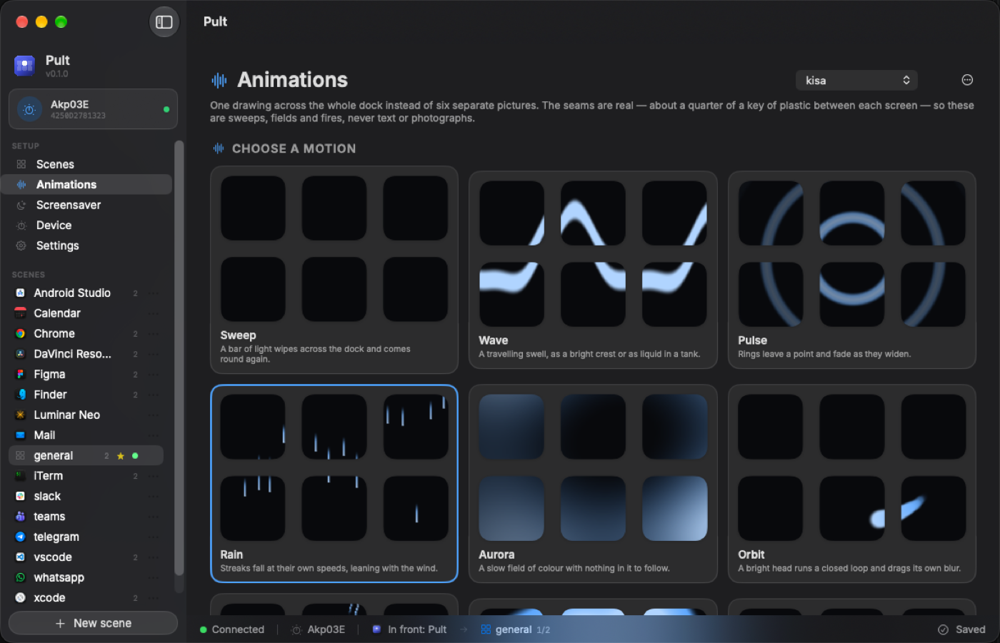
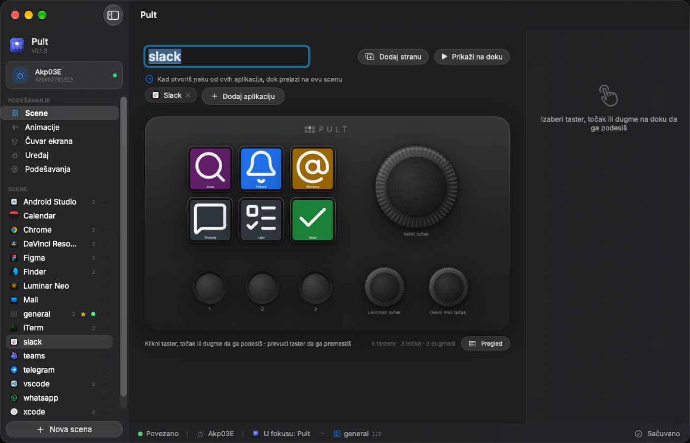
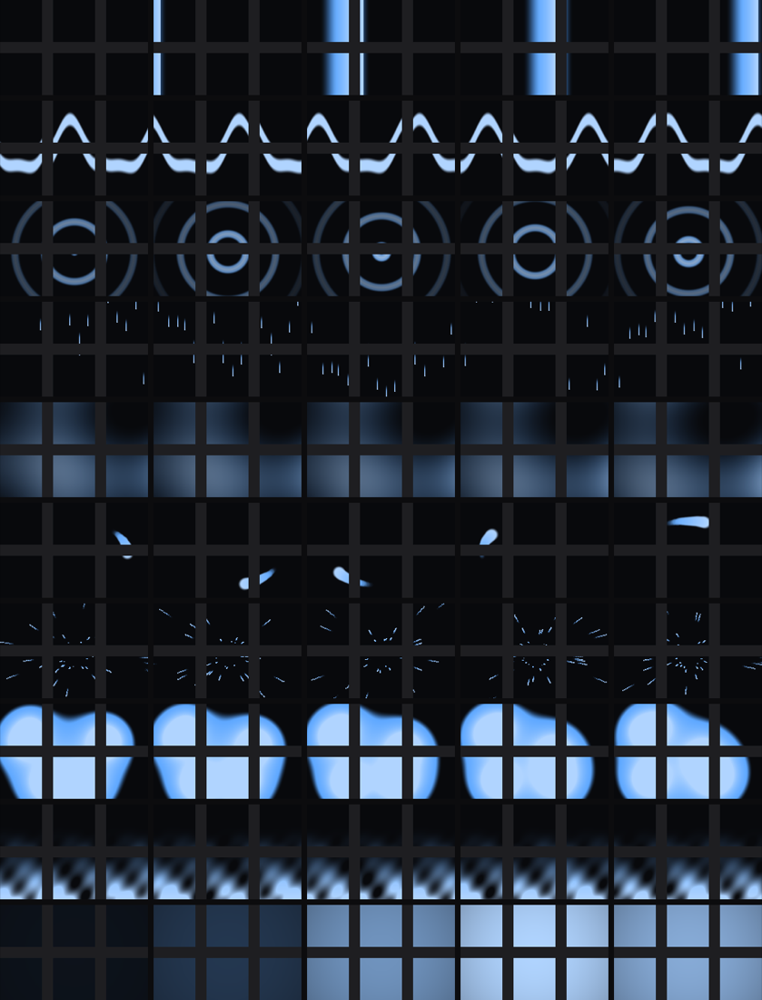

# Pult

A macOS controller for the **Ajazz AKP03E** stream dock. The six keys repaint
themselves when you switch applications, and the whole dock can become one
moving picture instead of six separate ones.



```
macOS frontmost app  →  bundle ID  →  scene  →  6 × JPEG 60×60 + an action table
```

The dock stores nothing but its boot logo. Every scene lives on your Mac and is
pushed over HID, so nothing is lost when it is unplugged and nothing has to be
synchronised.

## Install

Download the disk image from [Releases](../../releases), drag Pult into
Applications and open it. The first screen starts the background service and
points at the one permission that has to be granted by hand.

Keys bound to a keystroke need **System Settings › Privacy & Security ›
Accessibility** (called *Device Control and Data Access* on macOS 27). Tick
`pultd` there — the daemon, not the app: the app does not press keys, the
daemon does. Keys bound to `run` or `volume` work without it.

## What it does

**Scenes.** One per application, matched on bundle ID. Six keys with a label, an
icon and an action; three plain buttons; three encoders, each with a twist in
either direction and a press of its own. More than six tools? Bind a knob to
turn pages.

**Animations.** A scene can paint across the whole dock instead of six separate
pictures. Ten built-in motions, or a file of your own — a GIF, an animated PNG
or WebP, a folder of numbered frames, or one still picture.

**A screensaver.** When nobody has touched the Mac for a while the dock stops
being a controller and becomes something to look at, cycling through a playlist
of animations and dissolving between them. Nothing in Pult keeps the Mac awake;
it asks to paint one last frame before sleep and then lets go.

**Both languages.** English and Serbian, switched live, along with a text size
that scales the whole interface.



*The scene editor, here in Serbian.*

## The hardware

| | |
|---|---|
| Model | Ajazz AKP03E (`0300:3002`, Mirabox protocol v2) |
| Keys with displays | 6, laid out 2×3, JPEG 60×60 |
| Keys without displays | 3 |
| Encoders | 3, each CW / CCW / press |
| Boot logo | 320×240, the only thing stored on the device |

Indices, confirmed by pressing every control on the hardware:

```
        keys 0 1 2          encoder 1  (big knob, top)
             3 4 5

     buttons 6 7 8          encoder 0      encoder 2
             (round, no display)   (small knobs, bottom)
```

Measured on the wire: one key is 1.2 ms, all six plus a flush is 5.2 ms. At 15
frames a second a full-dock animation spends about 8% of the dock's time
receiving pictures, and well under 1% of a core drawing them.

## Animations, and the seams

Six 60×60 screens with plastic between them are not a 180×120 image. The gaps
are real — about a quarter of a key — so a canvas is larger than the sum of its
keys, and each key is a window cut out of it.



*Every effect as the dock really shows it, bezels included.*

Which geometry is right depends on what is being drawn:

* **Physical** — 212×136, true geometry. A circle stays round and a diagonal
  stays straight, at the cost that a travelling front disappears for the width
  of each bezel. Right for rings, orbits and anything with a shape.
* **Packed** — 180×120, gaps ignored. A front crosses at constant apparent
  speed and never stalls. Right for sweeps and meters.

Static text and photographs belong on neither: a letter cut by 16 px of plastic
is a letter gone.

Every effect is a pure function of `(phase, seed)`. Phase is an accumulator the
daemon advances by `dt × speed`, which is why moving the speed slider changes
how fast the picture moves and never where it is. Each effect also declares the
settings it honours and the range it will accept, and the editor builds its
controls from that — so a slider can never outlive the thing it drives, and a
new effect grows the gallery with no change to the app.

## Configuration

Everything the interface does is a file at `~/.config/pult/config.toml`, written
from [`config.example.toml`](config.example.toml) on first run and documented in
place. It is picked up while the daemon runs; a file that fails to parse is
reported and the running one is kept.

The file and the app are interchangeable in both directions. Anything the app
does not understand — a key from a newer build, a table added by hand — survives
a save untouched rather than being quietly dropped.

## Build from source

Rust and a Swift toolchain, both from the usual places.

```sh
./scripts/build-app.sh     # daemon + app + icon, bundled and signed
./scripts/install.sh       # the above, into /Applications, as a login agent
./scripts/make-dmg.sh      # a disk image you can hand to someone
./scripts/notarize.sh      # submit it to Apple and staple the ticket
```

`build-app.sh` signs with a **Developer ID Application** certificate when the
machine has one, and with a locally generated certificate when it does not. The
local path is enough for your own Mac and keeps the Accessibility grant stable
across rebuilds, but no other Mac will accept it — for that it has to be signed
with a Developer ID *and* notarised, which is what `notarize.sh` does.

Tools, most of them useful without a dock attached:

```sh
cargo run --bin sheet                        # every effect, with real seams, to a PNG
cargo run --bin preview -- chrome:2 out.png  # one scene's page, to a PNG
cargo run --bin bench                        # how fast the dock accepts images
cargo run --bin probe                        # geometry, then live key and encoder events
cargo run --bin probe -- --raw               # hex dump of raw HID input
cargo run --bin opentest                     # which HID interface can be opened
```

## Why a daemon and an app

Only one process may hold the device, so the two are separate and talk over a
line-delimited JSON socket at
`~/Library/Application Support/Pult/control.sock`. The daemon owns the HID
connection and nothing else touches it.

The split is also what makes the permission work. macOS attaches the right to
send keystrokes to the *responsible* process, which for anything started from a
terminal is the terminal — or the editor behind it. As a login agent the daemon
answers for itself, so the grant lands on `pultd` and stays there.

## Two things worth knowing

**Why the frontmost app is read with `lsappinfo`.** The obvious call,
`NSWorkspace.frontmostApplication`, goes stale in a background process. That is
the root cause of app-based profile switching not working on macOS in OpenDeck
(issue #455, closed as *not planned*) and in its upstream library
(`active-win-pos-rs` #49, still open). `lsappinfo` asks the launch services
daemon instead, stays correct from the background, and needs no permission.

**Why `vendor/ajazz-sdk` exists.** The dock exposes its vendor pipe *and* a
plain keyboard under one VID/PID/serial. The upstream SDK connects by serial, so
it can land on the keyboard interface, which macOS refuses without Input
Monitoring — `connect()` fails with `(0xE00002C1) privilege violation`. The
vendored copy adds one function, `Ajazz::connect_path`, so the vendor pipe is
opened by path. See [`vendor/ajazz-sdk/PATCHES.md`](vendor/ajazz-sdk/PATCHES.md).

## Licence

MIT — see [LICENSE](LICENSE).

Pult vendors a patched Ajazz SDK under MPL-2.0 and bundles the Lucide icon set
and the Inter typeface. [THIRD-PARTY.md](THIRD-PARTY.md) names all of them,
their terms, and what was changed.
